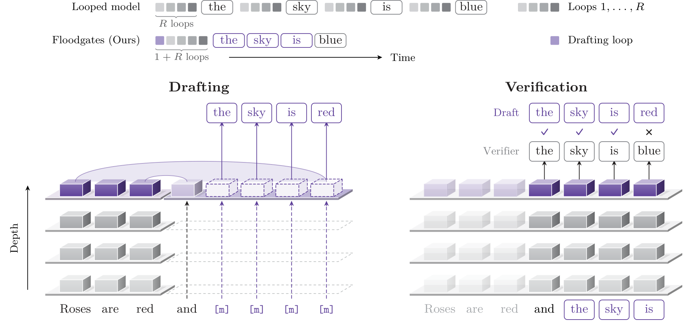

<div align="center">

# Looped Models are Fast Multi-Token Predictors

**[Ayhan Suleymanzade](https://misakitaro0414.github.io/)**<sup>1</sup> &nbsp;&nbsp; **[Sean McLeish](https://mcleish7.github.io/)**<sup>1,2</sup> &nbsp;&nbsp; **[Sehoon Kim](https://sehoonkim.org/)**<sup>3</sup> &nbsp;&nbsp; **[Jinwoo Kim](https://jw9730.github.io/)**<sup>3</sup> &nbsp;&nbsp; **[Antoine Bosselut](https://atcbosselut.github.io/)**<sup>1</sup>

<sup>1</sup>EPFL &nbsp;&nbsp; <sup>2</sup>University of Maryland &nbsp;&nbsp; <sup>3</sup>KAIST

[](https://arxiv.org/abs/2611.33896)
[](LICENSE)
[](https://www.python.org/)
[](https://huggingface.co/MisakiTaro0414/floodgates)



</div>

## Setup

```bash
git clone https://github.com/MisakiTaro0414/floodgates.git
cd floodgates
python3.11 -m venv .venv && source .venv/bin/activate
pip install torch==2.11.0 --index-url https://download.pytorch.org/whl/cu130
pip install -r requirements.txt
bash scripts/download_models.sh     # the seven base models
```

The base models are stored in `$LOOPSPEC_DIR/models` (default `../looped_refs/loopspec/models`). The paper's numbers are from a single NVIDIA A100-80GB.

## Pretrained Drafters

| Base model | Speedup | HF Link |
|:---|:---:|:---|
| Ouro-1.4B | 5.04x | [floodgates-Ouro-1.4B](https://huggingface.co/MisakiTaro0414/floodgates/tree/main/floodgates-Ouro-1.4B) |
| Ouro-2.6B | 5.56x | [floodgates-Ouro-2.6B](https://huggingface.co/MisakiTaro0414/floodgates/tree/main/floodgates-Ouro-2.6B) |
| Ouro-1.4B-Thinking | 3.70x | [floodgates-Ouro-1.4B-Thinking](https://huggingface.co/MisakiTaro0414/floodgates/tree/main/floodgates-Ouro-1.4B-Thinking) |
| Ouro-2.6B-Thinking | 3.90x | [floodgates-Ouro-2.6B-Thinking](https://huggingface.co/MisakiTaro0414/floodgates/tree/main/floodgates-Ouro-2.6B-Thinking) |
| Recurrent-Llama-3.2 | 5.04x | [floodgates-Recurrent-Llama-3.2-train-recurrence-32](https://huggingface.co/MisakiTaro0414/floodgates/tree/main/floodgates-Recurrent-Llama-3.2-train-recurrence-32) |
| Recurrent-TinyLlama | 6.73x | [floodgates-Recurrent-TinyLlama-3T-train-recurrence-32](https://huggingface.co/MisakiTaro0414/floodgates/tree/main/floodgates-Recurrent-TinyLlama-3T-train-recurrence-32) |
| Huginn-3.5B | 4.48x | [floodgates-huginn-0125](https://huggingface.co/MisakiTaro0414/floodgates/tree/main/floodgates-huginn-0125) |

Speedup over plain decoding on GSM8K at batch size one, with greedy decoding.

```bash
bash scripts/download_checkpoints.sh   # downloads all seven into runs/
```

## Evaluation

```bash
RUN=runs/floodgates-Ouro-1.4B TASK=gsm8k bash scripts/bench_greedy.sh                       # greedy decoding
RUN=runs/floodgates-huginn-0125 TASK=gsm8k PASSES=24 bash scripts/bench_greedy.sh
RUN=runs/floodgates-Ouro-1.4B TASK=gsm8k bash scripts/bench_sampling.sh                     # sampling
RUN=runs/floodgates-Ouro-1.4B BATCHES=1,8,32 bash scripts/bench_serving.sh                  # batched serving
```

`TASK` is one of `gsm8k`, `math500`, `humaneval`, `mbpp`, `bbh` (`gsm8kchat`, `math500chat` for the Thinking models). The training-free baselines run from a spec, for example `SPEC=das:2,8:rl32`, and DFlash, WaveFront and the dense-model controls are in [`baselines/`](baselines/).

## Training

```bash
MODEL=Recurrent-Llama-3.2-train-recurrence-32 TAG=rl32 bash scripts/gen_data.sh   # self-generated data
DATA=data/mix4c_rl32_greedy.jsonl bash scripts/train_raven.sh                     # Recurrent-Llama, Recurrent-TinyLlama, Huginn
DATA=data/mix4c_ouro14_greedy.jsonl bash scripts/train_ouro.sh                    # Ouro
```

The Ouro data come from the SGLang server of LoopSpec; see [`datagen/`](datagen/).

## Key Arguments

Environment variables of the scripts; the defaults are the paper's settings.

| Variable | Description | Default |
|:---|:---|:---:|
| `RUN` | Drafter directory | required |
| `TASK` | Benchmark | `gsm8k` |
| `PASSES` | Elastic drafting passes $E$ (Recurrent-Llama, Recurrent-TinyLlama, Huginn) | `0` |
| `TEMP`, `TOP_P` | Sampling temperature and nucleus | `1.0`, `0.7` |
| `BATCHES` | Batch sizes of the serving benchmark | `1,2,4,8,16,32` |
| `K`, `RANK`, `STEPS` | Mask tokens, adapter rank, training steps | `12`, `64`, `32000` |

## Citation

```bibtex
@misc{suleymanzade2026loopedmodelsfastmultitoken,
  title={Looped Models are Fast Multi-Token Predictors},
  author={Ayhan Suleymanzade and Sean McLeish and Sehoon Kim and Jinwoo Kim and Antoine Bosselut},
  year={2026},
  eprint={2611.33896},
  archivePrefix={arXiv},
  primaryClass={cs.LG},
  url={https://arxiv.org/abs/2611.33896},
}
```

## Acknowledgements

The prompts, stop strings and scoring follow [LoopSpec](https://github.com/kaist-flexml-lab/loopspec). The models are [Ouro](https://huggingface.co/ByteDance/Ouro-1.4B), [Huginn](https://huggingface.co/tomg-group-umd/huginn-0125) and the [recurrent retrofits](https://huggingface.co/smcleish) of Llama-3.2 and TinyLlama. We thank the authors for releasing their models and code.
